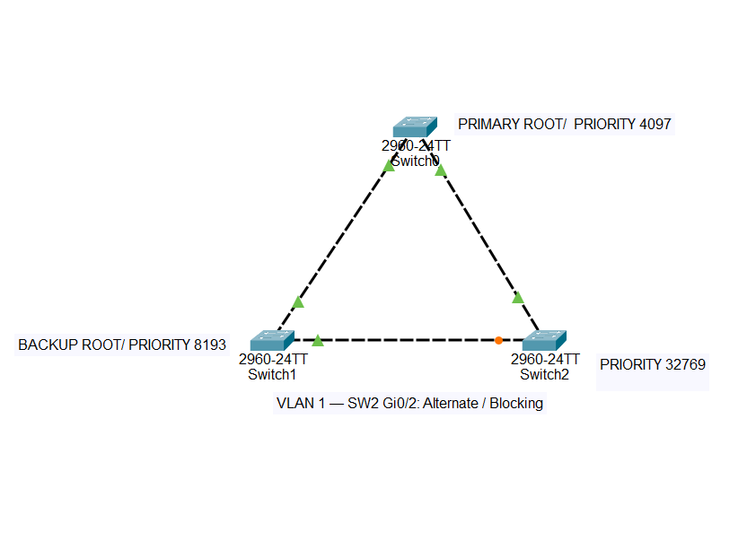

# Lab 03 — Spanning Tree Protocol (STP)

Configured a redundant three-switch network in Cisco Packet Tracer and tested STP root bridge election, alternate path activation, and recovery after failures.

## Topology



- Three Cisco 2960 switches connected in a triangle.
- Gigabit Ethernet links, using VLAN 1.
- Default PVST+ operation; Rapid PVST+ was not configured.
- Device labels Switch0, Switch1, and Switch2 correspond to CLI hostnames SW0, SW1, and SW2.

### Link Connections

| Switch | Interface | Connected to | Remote interface |
|---|---|---|---|
| SW0 | Gi0/1 | SW1 | Gi0/1 |
| SW0 | Gi0/2 | SW2 | Gi0/1 |
| SW1 | Gi0/2 | SW2 | Gi0/2 |

## Root Bridge Configuration

| Switch | Role | Configured priority | Displayed priority for VLAN 1 |
|---|---|---|---|
| SW0 | Primary root | 4096 | 4097 |
| SW1 | Backup root | 8192 | 8193 |
| SW2 | Non-root switch | 32768 (default) | 32769 |

The displayed priority includes the VLAN ID: configured priority + 1 for VLAN 1.

### SW0

```text
configure terminal
spanning-tree vlan 1 priority 4096
end
```

### SW1

```text
configure terminal
spanning-tree vlan 1 priority 8192
end
```

## Verification and Failure Tests

Used `show spanning-tree vlan 1` to verify the root bridge, root path cost, and interface roles and states.

| Test | Action | Observed result |
|---|---|---|
| Root election | Reduced SW0 priority to 4096 | SW0 became the root bridge |
| Normal operation | All three links active | SW2 Gi0/1 was Root FWD; Gi0/2 was Altn BLK |
| Link failure | Shut down SW2 Gi0/1 | Gi0/2 changed to Root FWD; root path cost increased from 4 to 8 |
| Link recovery | Re-enabled SW2 Gi0/1 | Gi0/1 returned to Root FWD; Gi0/2 returned to Altn BLK; root path cost returned to 4 |
| Primary root isolation | Shut down both SW0 Gigabit interfaces | SW1 became root for the connected SW1–SW2 network, with displayed priority 8193 |
| Primary root recovery | Re-enabled both SW0 Gigabit interfaces | SW0 regained the root role |

### Link Failure and Recovery — SW2

```text
configure terminal
interface gigabitEthernet 0/1
shutdown
end
show spanning-tree vlan 1
```

After allowing STP to converge, restored the link:

```text
configure terminal
interface gigabitEthernet 0/1
no shutdown
end
```

### Primary Root Isolation and Recovery — SW0

```text
configure terminal
interface range gigabitEthernet 0/1 - 2
shutdown
end
```

Verified the new root on SW1, then restored SW0:

```text
configure terminal
interface range gigabitEthernet 0/1 - 2
no shutdown
end
```

## Troubleshooting

During the root isolation test, SW1 displayed `No spanning tree instance exists`.

- `show interfaces status` revealed that both SW1 Gigabit interfaces were administratively disabled.
- `show vlan brief` confirmed that VLAN 1 was active.
- Re-enabled the SW1 interfaces and applied the shutdown commands to SW0.
- Repeated the test and confirmed that SW1 became the root.

## Key Takeaways

- Lower bridge priority controls root bridge election.
- A Root Port is a non-root switch's selected path toward the root bridge.
- STP blocks a redundant path to prevent Layer 2 loops.
- A blocked alternate port can become the forwarding root port after a link failure.
- Root path cost reflects the complete path to the root, rather than only the local port cost.
- Interface status checks help distinguish administrative shutdowns from STP blocking.

## Lab File

[Download the Packet Tracer lab](Lab03-STP.pkt)

All links were restored after testing, and configurations were saved on all three switches.

Validation focused on STP control-plane behaviour; end-host ping tests were not performed.

[Back to Networking Labs](https://github.com/rgsantos90/networking-labs)
